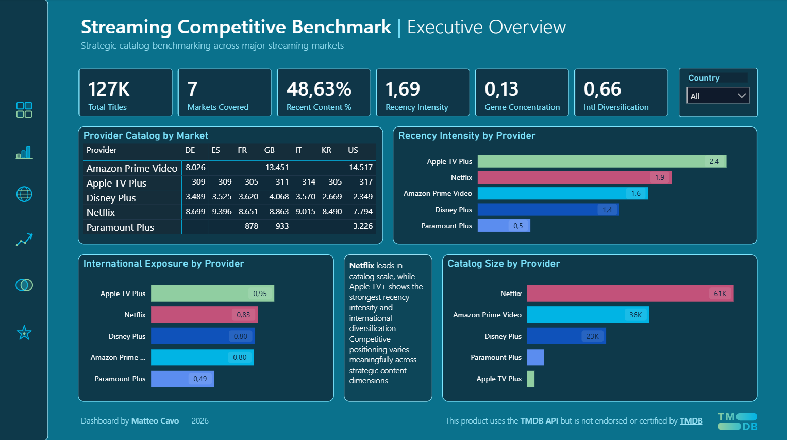
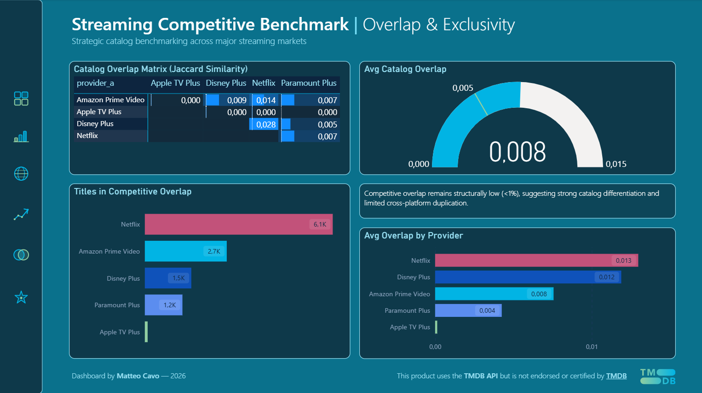

# 🎬 Streaming Competitive Benchmark

Strategic catalog benchmarking across major streaming markets.

This project analyzes how major streaming platforms differentiate their content catalogs across scale, recency, international reach, genre strategy, quality and competitive overlap.

**Platforms analyzed:** Netflix · Amazon Prime Video · Disney Plus · Apple TV Plus · Paramount Plus

**Markets analyzed:** DE · ES · FR · GB · IT · KR · US

---

## 🔹 Data Source

All title-level metadata used in this project is sourced from the TMDB (The Movie Database) API.

Data includes:
- Title metadata (movie / TV)
- Release year
- Genres
- Origin country
- Language
- Popularity
- Vote average
- Vote count

The dataset is collected programmatically via the TMDB API under its terms of service.

Official website: https://www.themoviedb.org/  
API documentation: https://developer.themoviedb.org/

> *This product uses the TMDB API but is not endorsed or certified by TMDB.*
>
> *Streaming availability data (watch providers) is provided by JustWatch, via the TMDB API.*

TMDB and JustWatch attributions are separate requirements: TMDB for the title metadata, JustWatch for the provider availability data.

Raw API responses are stored locally and not redistributed in this repository.
The versioned `data/mart/` files are the analytical marts. `provider_catalog_mart.parquet` is title-level (TMDB metadata and provider availability); the other two marts are aggregates. See the License section.

---

## 🔗 Live Dashboard

👉 **[View Interactive Power BI Dashboard](https://app.powerbi.com/view?r=eyJrIjoiMDVhNGNjNWQtYTc2YS00YmI0LTk2NzctMTcwNWU5OGM0MmM0IiwidCI6IjgwNjZmMmRlLTgxZDctNGVjNC04Y2E5LTgzNzVjOTA4NjViNSJ9)**

Full dashboard documentation: 📄 [`dashboard/README.md`](dashboard/README.md)

---

## 📊 Project Architecture

```
Streaming_Benchmark_Project/
│
├── notebooks/
│   ├── README.md                         # Pipeline documentation
│   ├── 01_ingestion.ipynb                # TMDB API data collection
│   ├── 02_cleaning.ipynb                 # Normalization & deduplication
│   └── 03_build_mart.ipynb               # Analytical mart construction
│
├── data/
│   ├── raw/                              # Raw API responses (gitignored)
│   ├── clean/                            # Normalized data (gitignored)
│   └── mart/
│       ├── provider_catalog_mart.parquet
│       ├── provider_market_metrics.parquet
│       └── overlap_matrix.parquet
│
├── dashboard/
│   ├── screenshots/                      # Dashboard page exports
│   └── README.md                         # Dashboard documentation
│
└── README.md
```

---

## 📓 Notebooks

Three-stage pipeline: collection → cleaning → mart build.

Full documentation: 📄 [`notebooks/README.md`](notebooks/README.md)

### `01_ingestion.ipynb` — Data Collection
Queries the TMDB API across a 5 providers × 7 markets grid. Handles pagination and rate limiting. Exports raw data to Parquet.

### `02_cleaning.ipynb` — Data Preparation
Normalizes schema, deduplicates titles by `(tmdb_id, media_type)` and availability by `(tmdb_id, media_type, provider_id, country)`, standardizes country codes, assigns recency buckets and computes weighted ratings.

### `03_build_mart.ipynb` — Analytical Mart
Builds three tables at different analytical grains: title-level, provider × market, and provider-pair. See [`notebooks/README.md`](notebooks/README.md) for full column documentation.

---

## 📈 Analytical Dimensions

| Dimension | Description |
|---|---|
| **Catalog Scale** | Total unique titles per provider and market |
| **Recency Investment** | Share and intensity of recent content |
| **Average Rating** | Vote-count-weighted average of TMDB `vote_average` (not validated as a catalog quality score, see limitations) |
| **International Exposure** | Non-local content share and language diversity |
| **Genre Concentration** | Herfindahl index on primary genre distribution |
| **Competitive Overlap** | Jaccard similarity across all provider pairs |

---

## 📸 Dashboard Preview

### Executive Overview


### Overlap & Exclusivity


For the full dashboard breakdown and documentation → 👉 [`dashboard/README.md`](dashboard/README.md)

---

## 🛠️ Tech Stack

| Tool | Usage |
|---|---|
| Python 3 | Data pipeline |
| `requests` | TMDB API calls |
| `pandas` | Data transformation |
| `pyarrow` | Parquet I/O |
| Power BI Desktop | Dashboard & visualization |
| DAX | Analytical measures |

---

## ⚙️ Setup

```bash
git clone https://github.com/matteocavo/Streaming_Competitive_Benchmark
cd Streaming_Competitive_Benchmark
python -m pip install requests pandas numpy pyarrow jupyter
export TMDB_API_KEY="your_api_key_here"
```

`pyarrow` reads and writes the Parquet marts. No versions are pinned because the
repository has no tested lockfile.

Run notebooks in order — see [`notebooks/README.md`](notebooks/README.md) for details.

---

## ⚠️ Dataset Limitations

| Limitation | Impact |
|---|---|
| **TMDB catalog coverage** | TMDB reflects reported availability, not contractual licensing. Some titles may be missing or misclassified by provider |
| **Partial market coverage** | Amazon Prime Video data available only for DE, GB, US — TMDB does not map flatrate availability for IT, FR, ES, KR. Paramount Plus available only for US, GB, FR |
| **Watch provider API constraints** | TMDB `/watch/providers` endpoint returns current availability — historical catalog changes are not captured |
| **Popularity bias** | `popularity` score is TMDB-internal and recency-weighted. Older titles are systematically underscored regardless of cultural relevance |
| **Vote coverage and rating weights** | `weighted_rating` is `sum(vote_average × vote_count) / sum(vote_count)` over title–market rows. Titles with `vote_count = 0` (8,765 of 127,399 rows, 6.9%) carry zero weight, so they are excluded in effect rather than scored as 0. Heavily voted titles dominate the result (the top 1% of rows hold 12% to 38% of all votes depending on the provider). Treat provider rating comparisons as unvalidated |
| **Counting units** | `catalog_size` counts title–market observations (127,399 in total, 60,908 for Netflix across 7 markets). `unique_titles` counts distinct `tmdb_id` values within a provider–market pair. Netflix has 14,459 distinct title IDs across all markets. The dashboard labels "Total Titles" (127K) and Netflix "61K" show observations, not unique titles |
| **Duplicate rows after provider mapping** | Paramount Plus US has 1,371 duplicate `(tmdb_id, media_type, provider, country)` rows after provider names are mapped to one canonical name (3,226 rows against 1,855 distinct). Other provider–market pairs have none. `catalog_size` for Paramount Plus US is overstated; the marts have not been regenerated |
| **`tmdb_id` across media types** | `unique_titles` and the Jaccard sets use `tmdb_id` alone, but 307 (provider, market, `tmdb_id`) combinations appear both as movie and as TV. A check on `(media_type, tmdb_id)` keys with deduplicated rows gives an average pairwise Jaccard of about 0.007 instead of 0.008. The published marts have not been regenerated |
| **Language normalization** | `original_language` reflects primary production language — multilingual co-productions are assigned a single code |

These limitations should be considered when interpreting the results. Absolute values are affected by the duplicate rows and ID collisions above, and relative comparisons across providers have not been validated: Paramount Plus US is overstated, movie/TV ID collisions change overlap counts (the largest changes in a check were in pairs that include Amazon Prime Video), and rating comparisons are unvalidated.

---

## 📄 License

Original code is licensed under the [MIT License](LICENSE). TMDB metadata remains
subject to TMDB's terms; the software license does not relicense source data.
Raw API responses are not redistributed. `data/mart/provider_catalog_mart.parquet` is
title-level: it holds TMDB metadata per title (ID, title, genres, ratings, popularity)
and the provider availability per market, sourced via JustWatch. The two smaller marts
are aggregates. All of these remain subject to TMDB's terms and JustWatch attribution;
the MIT License covers the original code, not the source data. Redistribution of the
title-level file is under review.

---

## Related work

[Streaming Metadata Analytics](https://github.com/matteocavo/streaming-metadata-analytics)
uses synthetic viewing data to demonstrate engagement KPIs; this project instead
benchmarks reported TMDB catalog availability. Neither dataset proves causal
content strategy effects.
*Matteo Cavo — 2026*
