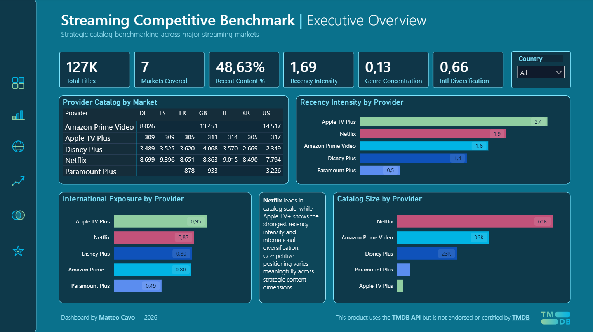
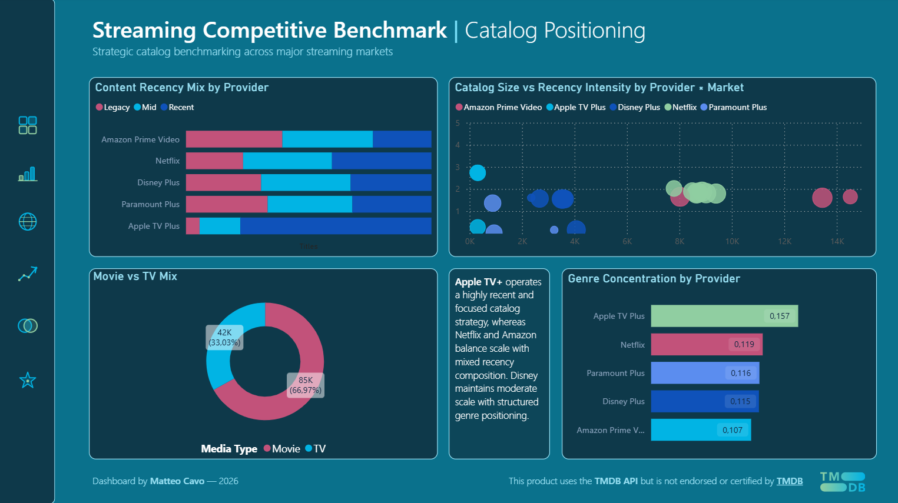
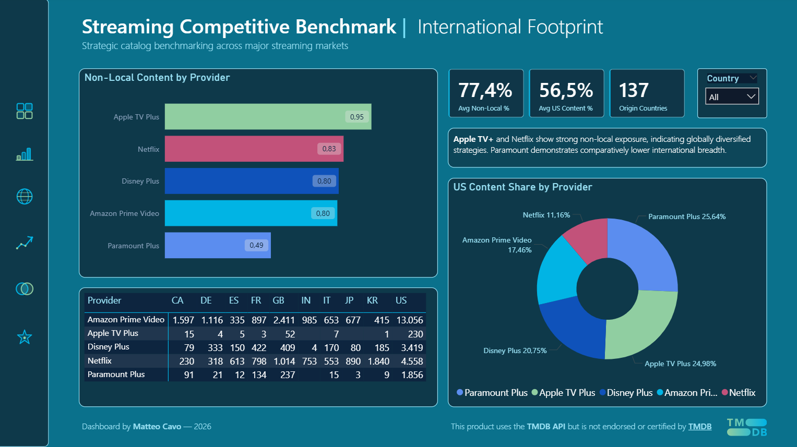
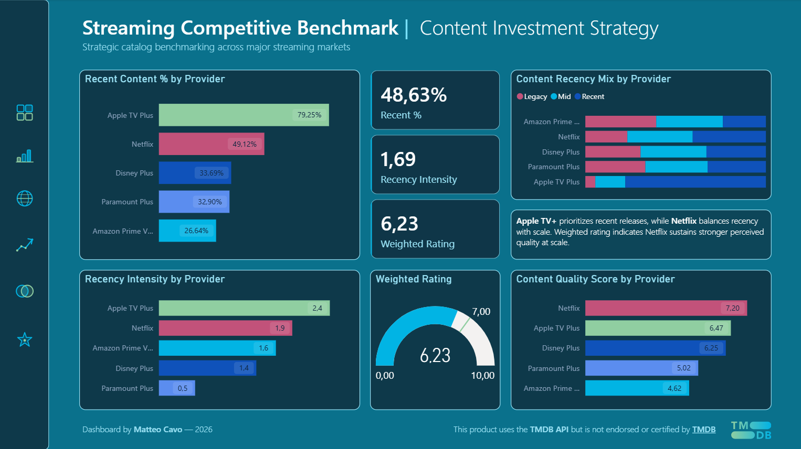
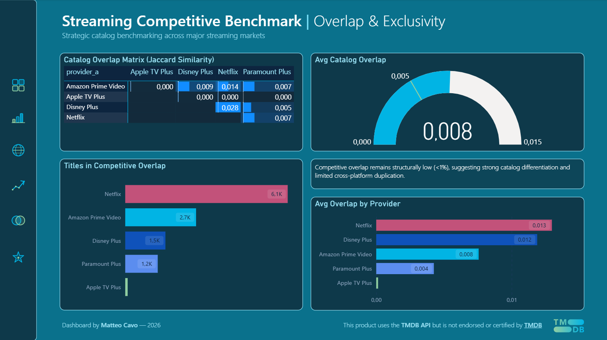
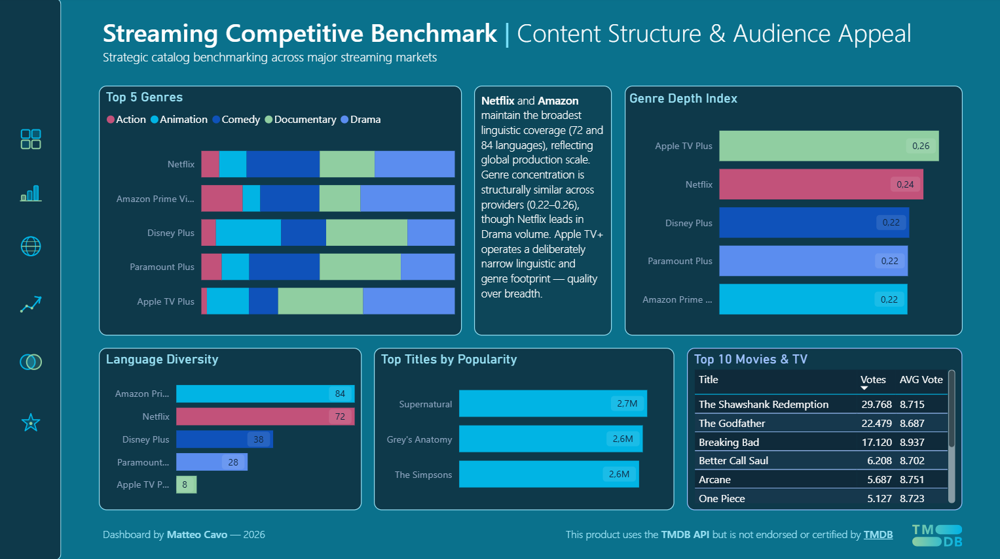

# 📊 Streaming Competitive Benchmark — Dashboard

Strategic catalog benchmarking across major streaming markets.

Interactive executive dashboard analyzing catalog differentiation across five major streaming platforms in seven global markets.

> *This product uses the TMDB API but is not endorsed or certified by TMDB.*
>
> *Streaming availability data (watch providers) is provided by JustWatch, via the TMDB API.*

---

## 🔗 Live Dashboard

👉 **[View Interactive Dashboard](https://app.powerbi.com/view?r=eyJrIjoiMDVhNGNjNWQtYTc2YS00YmI0LTk2NzctMTcwNWU5OGM0MmM0IiwidCI6IjgwNjZmMmRlLTgxZDctNGVjNC04Y2E5LTgzNzVjOTA4NjViNSJ9)**

---

## 📘 Dashboard Structure

> **Reading the numbers:** "Total Titles" (127K) and catalog sizes such as Netflix "61K" count title–market observations: 127,399 in total, 60,908 for Netflix across 7 markets. Netflix has 14,459 distinct TMDB title IDs. Paramount Plus US is overstated by 1,371 duplicate rows. See the limitations in the [main README](../README.md).

### 1️⃣ Executive Overview


High-level benchmarking across Total Titles, Markets Covered, Recent Content %, Recency Intensity, Genre Concentration and International Diversification.

**Key insight:** Platforms follow structurally different catalog strategies — scale vs freshness vs diversification.

---

### 2️⃣ Catalog Positioning


Analyzes recency mix (Legacy / Mid / Recent), catalog size vs Recency Intensity, Movie vs TV split and genre concentration.

**Key insight:** Apple TV+ operates a focused, recent catalog. Netflix and Amazon balance scale with mixed recency. Disney positions structurally between both.

---

### 3️⃣ International Footprint


Evaluates non-local content %, US content share and origin country distribution across providers and markets.

**Key insight:** Netflix shows the broadest international production footprint. Apple TV+ and Netflix display the strongest non-local exposure across all providers.

---

### 4️⃣ Content Investment Strategy


Benchmarks Recent Content %, Recency Intensity, Weighted Rating and Quality Score by provider. Weighted Rating is a vote-count-weighted average and is dominated by heavily voted titles; provider comparisons are not validated.

**Key insight:** Netflix combines a large catalog (60,908 title–market observations, 14,459 distinct TMDB IDs) with a high share of recent content. Apple TV+ prioritizes freshness over breadth.

---

### 5️⃣ Overlap & Exclusivity


Uses Jaccard similarity to measure catalog intersection across all platform pairs.

**Key insight:** Average Jaccard Similarity = 0.008 as shown (self-comparisons excluded) — overlap below 1% across provider pairs. A check on corrected keys gives about 0.007; the published marts are not regenerated. Apple TV+ shares at most 3 titles with any other provider in any market (at most 1 on corrected keys). Disney+ and Netflix show the highest overlap (Jaccard about 0.04 in FR, IT and GB).

---

### 6️⃣ Content Structure & Audience Appeal


Explores top 5 genres by provider, genre depth index, language diversity, top titles by popularity and top-rated movies & TV.

**Key insight:** Genre concentration is similar across platforms: provider–market values range from 0.10 to 0.16 in `provider_market_metrics.parquet`. Apple TV+ has the narrowest linguistic and genre footprint. Amazon and Netflix lead in language diversity (84 and 72 languages).

---

## 🧮 Data Model

```
DimProvider (calculated)
    └── canonical_provider (PK)
           ↓
           ├── provider_catalog_mart [canonical_provider]
           └── provider_market_metrics [canonical_provider]

DimMarket (calculated)
    └── country (PK)
           ↓
           ├── provider_catalog_mart [country]
           └── provider_market_metrics [country]

overlap_matrix (standalone — no relationships)
```

> `overlap_matrix` has no direct relationship with DimProvider — it operates at provider-pair grain rather than individual provider grain.

---

## 📁 Data Sources

| File | Grain |
|---|---|
| `provider_catalog_mart.parquet` | title × provider × market |
| `provider_market_metrics.parquet` | provider × market |
| `overlap_matrix.parquet` | provider pair |

Generated via Python pipeline — see [main README](../README.md).

---

*Dashboard by Matteo Cavo — 2026*
